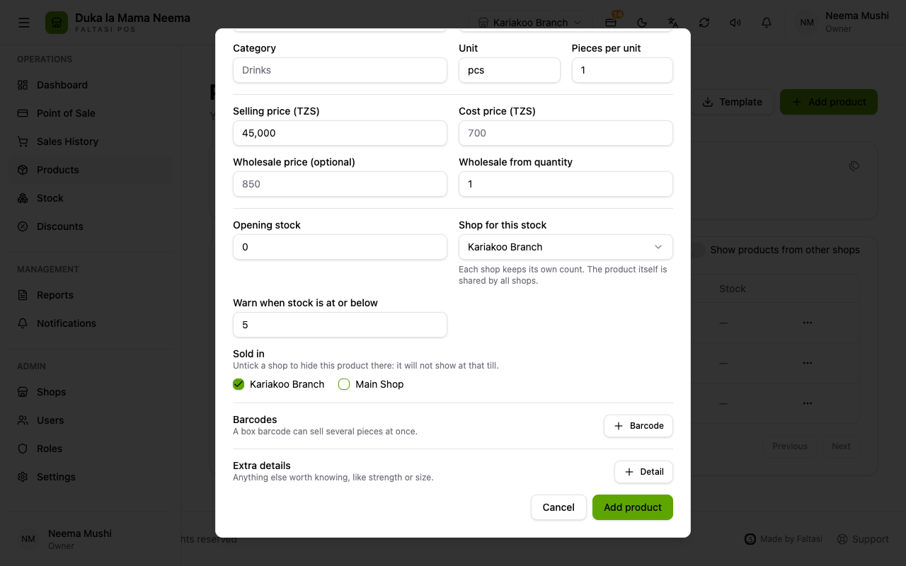
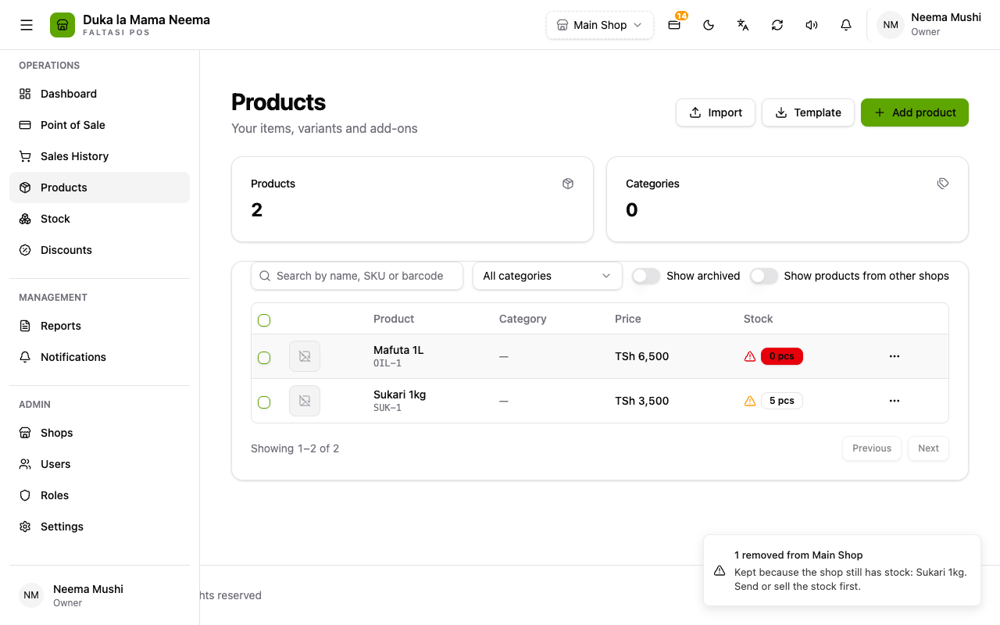
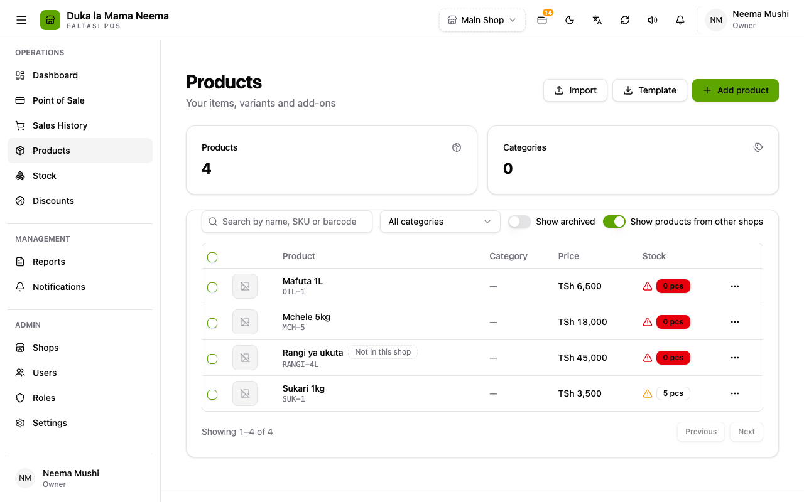
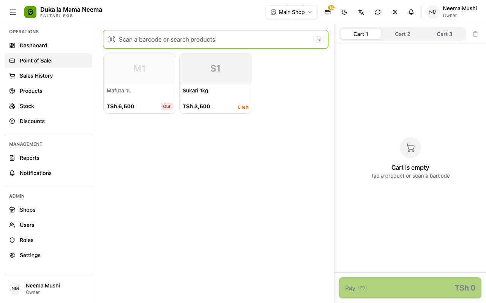

# Products per shop

**Added in v2.0.11 (12 Oct 2026).** Online, for businesses with more than one shop.

Each shop can sell its own set of products. A product the shop does not carry does not show in its product list or at its till, and cannot be sold there.

## Why it was added

The owner asked for each shop to have its own products. Before, every product of the business showed in every shop: a hardware branch saw the food shop's products at its till, with 0 stock.

Stock was already counted per shop. This adds the choice of which shops sell a product.

## How it works

Products are still shared by the business: one "Sukari 1kg", one price, one barcode. What changes per shop is whether it is sold there.

Nothing changes until the owner chooses: every existing product stays sold in every shop.

### When adding or editing a product

**Products (Bidhaa)** → **Add product (Ongeza bidhaa)** or **Edit**: under **Sold in (Inauzwa katika)**, untick the shops that do not sell it. At least one shop must stay ticked. A new variant (for example a colour) is sold in the same shops as its product.

### Many products at once

1. On **Products**, tick the products.
2. Press **Add to a shop (Ongeza kwenye duka)** or **Remove from a shop (Ondoa kwenye duka)**.
3. Choose the shop and confirm.

A shop that still has stock of a product keeps it, and the message names those products: send the stock to another shop or sell it first.

### Seeing the other shops' products

The owner can switch on **Show products from other shops (Onyesha bidhaa za maduka mengine)**. Products not sold in the current shop then show with a **Not in this shop (Haipo duka hili)** tag, so they can be ticked and added.

### At the till

The till only shows and sells the shop's own products. Scanning a product the shop does not carry says "This product is not sold in this shop".

## Rules

| Situation | What happens |
| :--- | :--- |
| Stock of a product arrives in a shop (stock arrived, transfer, opening stock, stock change, refund back on the shelf) | The product is sold there again automatically |
| Removing a product from a shop that has stock of it | Refused; send or sell the stock first |
| Closed shops | Not shown in the choice and not changed |
| Staff | Only the owner sees **Sold in**, the switch and the add/remove buttons |
| One-shop businesses and the desktop app | No change |

Reports, past sales, stock history and the books are not affected.

## For developers

- Migration 000062: `shop_stock.is_listed BOOLEAN NOT NULL DEFAULT TRUE`. A product is sold in a shop unless that shop's row has `is_listed = false`, so no data migration was needed.
- Backend: `backend/internal/products/shop_availability.go` (`SetShopAvailability`, `applyShopIds`, `inheritHiddenShops`), list filter in `product_repository.go` (`include_other_shops`), `in_shop` and `hidden_shop_ids` on product views, `POST /api/products/shops` (`products:edit`). `stock.Repository.ChangeQuantity` relists on incoming stock; `SetListed` upserts the flag. Sales refuse unlisted products (`product_not_in_shop`).
- Test: `TestEachShopSellsOnlyTheProductsItCarries`.
- Frontend: `ProductFormDialog.vue` (Sold in), `pages/products/index.vue` (switch, bulk dialog), `components/products/columns.ts` (tag), `useProducts.setShopAvailability`.
- PRs: balceinv-api #84, balceinv #64. Details: `steps.md`, Phase 40.
