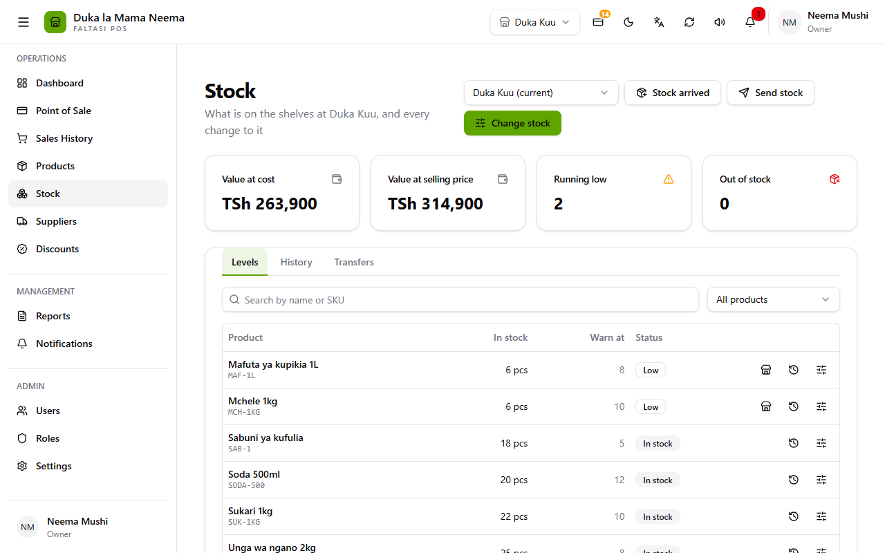
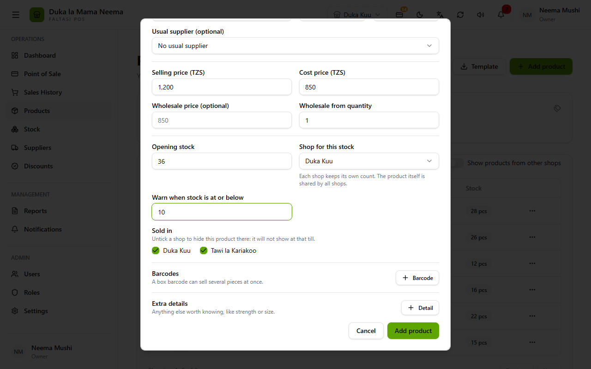
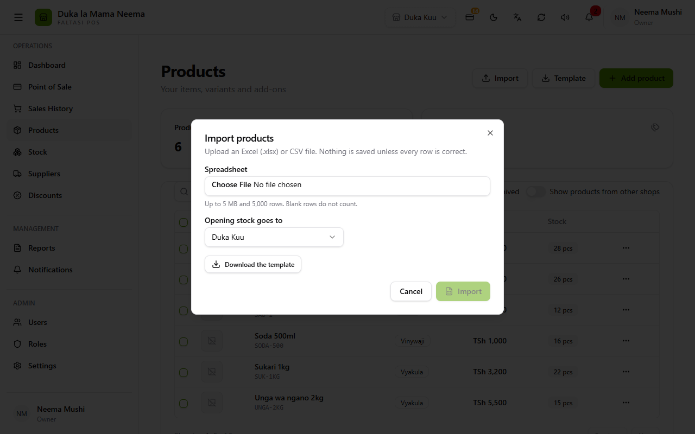
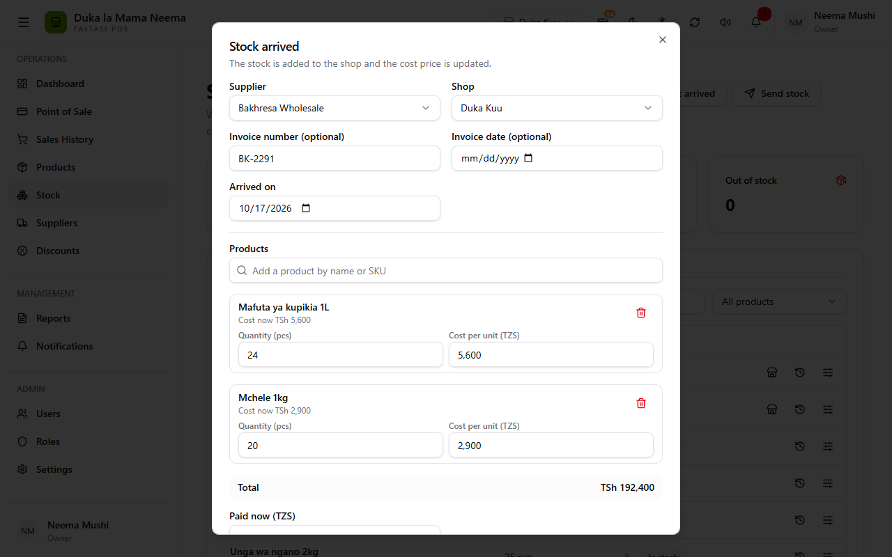
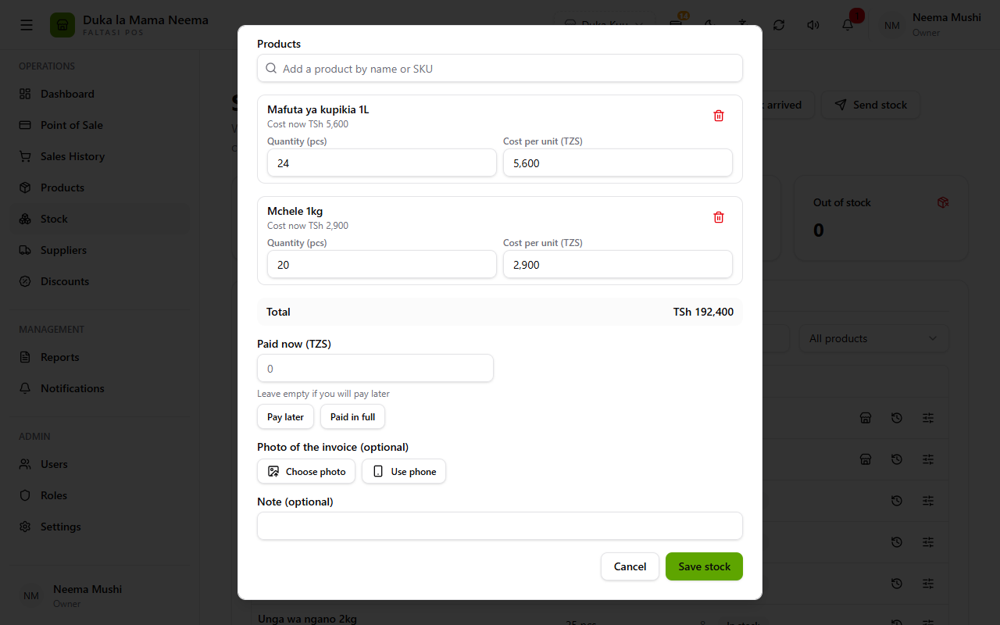
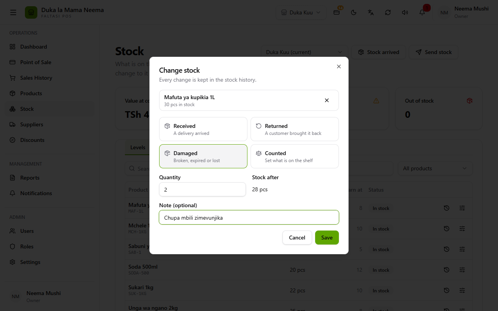
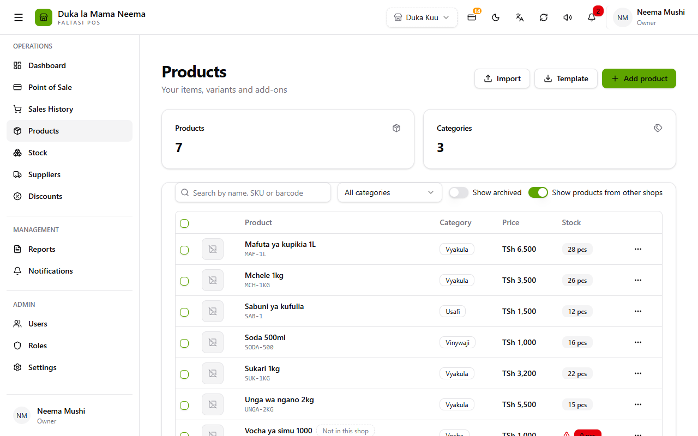

# Adding stock

A guide for the Balce sales and support team. No technical knowledge needed. Button and field names are written as **English (Kiswahili)**, exactly as the app shows them.

Each shop keeps its own count of every product. A product is shared by the whole business (one name, one price, one barcode). The **quantity** belongs to one shop. So every time stock is added, Balce needs to know **which shop** it goes into.

There are four ways to add stock. Pick the one that matches what happened:

| What happened | Use | Where |
| :--- | :--- | :--- |
| A brand-new product, with some already on the shelf | **Opening stock** on the product form | Products → **Add product (Ongeza bidhaa)** |
| Many new products at once, from Excel | **Import (Ingiza)** | Products → **Import** |
| A delivery came from a supplier | **Stock arrived (Stoku imefika)** | Stock → **Stock arrived** |
| A customer returned something, stock was damaged, or you counted the shelf | **Change stock (Badilisha stoku)** | Stock → **Change stock** |

Moving stock from one shop to another is **not** adding stock. See [Moving stock between shops](stock-transfers.md).

---

## 1. The Stock page

Open **Stock (Stoku)** in the menu.

| Part | What it does |
| :--- | :--- |
| **Shop picker** (top, "Duka Kuu (current)") | Which shop's stock you are looking at. Only shows if you work in more than one shop. **{shop} (current)** is the shop you are working in. **All shops (Maduka yote)** shows every shop side by side (see [Moving stock between shops](stock-transfers.md#3-see-every-shop-side-by-side)). Staff only see the shops they work in. |
| **Stock arrived (Stoku imefika)** | Record a delivery and what it cost. Only shows when **Suppliers** or the books are switched on in Settings → Features, and your role may record stock bought. |
| **Send stock (Tuma stoku)** | Move stock to another shop. Only shows if there are two or more shops. |
| **Change stock (Badilisha stoku)** | Returned, damaged or counted stock. Only for the shop you are working in, so it hides while the picker is on another shop. |
| **Value at cost** / **Value at selling price** | Everything on the shelves, priced at cost price and at selling price. |
| **Running low (Inakaribia kuisha)** | Products above 0 but at or below their warning level. |
| **Out of stock (Imeisha)** | Products at 0. This includes products that were never stocked in this shop. |
| **Levels (Viwango)** tab | One row per product (variants have their own row): how many are on the shelf, the warning level and the status. |
| **History (Historia)** tab | Every change, with the reason, who did it and what was left after. |
| **Transfers (Uhamisho)** tab | Stock sent to or received from other shops. |

On the **Levels** tab:

- **Search** looks at the name or SKU. It does not search barcodes; use the Products page for that.
- **All products / Low or out / Out of stock** filters the list. **Low or out (Ndogo au imeisha)** shows everything at or below its warning level, including 0.
- **Status** is **In stock (Ipo)**, **Low (Ndogo)** or **Out (Imeisha)**.
- The buttons at the end of each row:
  - the **clock** opens that product's history;
  - the **sliders** open Change stock for that product;
  - the **shop** icon, on Low or Out rows when there are other shops, shows which other shops have it.

> **The Levels list shows every product, even ones the shop does not sell** (see [Sold in](#sold-in-hides-a-product-from-a-shop)). They simply show 0 and Out.

---

## 2. A new product with stock on the shelf

1. **Products (Bidhaa)** → **Add product (Ongeza bidhaa)**.
2. Fill in the name, SKU and price as usual. **Pick from common products (Chagua kutoka bidhaa za kawaida)** fills these in for you.
3. Scroll down to the stock fields and fill them in (table below).
4. Press **Add product (Ongeza bidhaa)**.

| Field | What it does |
| :--- | :--- |
| **Opening stock (Stoku ya kuanzia)** | How many are on the shelf right now. Whole numbers only. Leave **0** if none yet. It is recorded in History as **Opening stock**. Only shown when adding; to change stock later, use Stock arrived or Change stock. |
| **Shop for this stock (Duka la stoku hii)** | Which shop the opening stock goes into. Starts on the shop you are working in. Only shown with more than one shop. Staff can only pick shops they work in. With one shop, the form says "Goes into {shop}" instead. |
| **Warn when stock is at or below (Onya stoku ikifika au chini ya)** | The warning level. When the count drops to this number the product shows **Low** and the bell (taarifa) warns; at 0 it shows **Out**. Default **5**. **It is kept per shop:** this number is saved for the shop chosen above. Other shops use 5 until someone edits the product while working in that shop. |
| **Sold in (Inauzwa katika)** | Which shops sell this product. Owner only, with more than one shop. See [the warning below](#sold-in-hides-a-product-from-a-shop). |
| **Unit (Kipimo)** | Shown after every number ("12 pcs"). Default **pcs**. |
| **Cost price (Bei ya kununua)** | Used for **Value at cost** and profit. Stock arrived updates it by itself later. |
| **Barcodes (Misimbopau)** → **pieces** | A box barcode can take several pieces off the shelf with one scan. |

**Variants** (size, colour): each variant has its own SKU, price and stock, and its own row on the Stock page. Add one with ⋯ → **Add variant (Ongeza aina)**; it asks for its own opening stock.

### Sold in hides a product from a shop

Unticking a shop under **Sold in** **hides the product and all its variants** from:

- that shop's **till**: it cannot be sold there, not even by scanning;
- that shop's **Products** list, unless the owner switches on **Show products from other shops**.

Things to know:

- At least one shop must stay ticked.
- When editing, you cannot untick a shop that still has stock of the product. Send or sell the stock first.
- **Any stock that comes into a shop switches the product back on there.** That includes opening stock, Stock arrived, Received or Returned, and stock received from another shop. So unticking a shop and giving it opening stock on the same form leaves it ticked.

---

## 3. Many products at once (Import)

1. **Products** → **Template (Kiolezo)**, or **Import** → **Download the template (Pakua kiolezo)**. You get `products-template.xlsx`.
2. Fill one product per row. **name**, **sku** and **price** are required. **quantity** is the opening stock. **minStock** is the warning level (5 if empty).
3. **Products** → **Import (Ingiza)**, choose the file, and check **Opening stock goes to**.
4. Press **Import**.

| Field | What it does |
| :--- | :--- |
| **Spreadsheet (Faili)** | An Excel (.xlsx) or CSV file. **Up to 5 MB and 5,000 rows. Blank rows do not count.** |
| **Opening stock goes to (Stoku ya mwanzo itaingia)** | Which shop gets the **quantity** column. Starts on the shop you are working in. Only shown with more than one shop. With one shop, the dialog names the shop instead. |
| **Download the template (Pakua kiolezo)** | The file with the right columns and one example row. |

**All or nothing:** if any row has a mistake, nothing is saved. A table then lists the **Row**, **Column** and **Problem**; fix those rows in Excel and import again.

If the message says the file itself cannot be used, check these:

- it is .xlsx or .csv;
- it has name, sku and price columns;
- it is within 5 MB and 5,000 rows.

Who can import: anyone whose role may **Create products (Ongeza bidhaa)**. A plain cashier cannot, and cannot download the template either.

---

## 4. A delivery from a supplier (Stock arrived)

1. **Stock** → **Stock arrived (Stoku imefika)**.
2. Choose the **Supplier** and check the **Shop**.
3. Add each product, with its **Quantity** and **Cost per unit**.
4. Fill in **Paid now**: press **Paid in full**, or leave it empty for **Pay later**.
5. Optionally add the invoice number, a photo of the invoice and a note.
6. Press **Save stock (Hifadhi stoku)**.

| Field | What it does |
| :--- | :--- |
| **Supplier (Msambazaji)** | Who delivered it. **No supplier (Bila msambazaji)** means it is paid in full now. Only shown when **Suppliers** is on in Settings → Features. |
| **Shop (Duka)** | Which shop the stock goes into. Starts on the shop you are working in. Only shown with more than one shop. |
| **Invoice number / Invoice date (optional)** | From the supplier's paper, to find it later. The date cannot be in the future. |
| **Arrived on (Imefika tarehe)** | The day it arrived. Default today. |
| **Products (Bidhaa)** | Search by name or SKU and tap the product. The quantity shown in the search is for **the shop you are working in**. |
| **Quantity ({unit}) (Idadi)** | How many came. Whole numbers above 0. |
| **Cost per unit (Bei ya kununua kwa kimoja)** | What one piece cost on this delivery. It starts on the last price paid. Saving updates the product's **cost price** to the average of the old and new stock. |
| **VAT on this invoice** | Only for VAT-registered businesses: no VAT, prices include VAT, or VAT added on top. |
| **Total (Jumla)** | Worked out for you. |
| **Paid now (Umelipa sasa)** | How much was paid today. **Pay later (Lipa baadaye)** leaves it at 0, and the supplier is owed the rest. **Paid in full (Imelipwa yote)** fills in the total. Without a supplier it is always the total. |
| **Paid by (Umelipa kwa)** | Cash, bank or mobile money, with the receipt or transaction number. Only shown when something was paid. |
| **Photo of the invoice (optional)** | **Choose photo** (up to 2 MB) or **Use phone** to take it with a phone camera. |
| **Note (optional)** | Anything else. |

In History, the stock shows as **Received (Imepokelewa)**, with the purchase number underneath. The first time a supplier delivers a product, that supplier becomes the product's **Usual supplier**.

> **Do not record a delivery twice.** Use Stock arrived for stock you bought; it keeps what you paid. Change stock → Received only adds the count. With the books on, Change stock → Received also counts as stock the owner brought in.

---

## 5. Returned, damaged or counted (Change stock)

1. **Stock** → **Change stock (Badilisha stoku)**, or the **sliders** button on a product's row.
2. Pick the product, if it is not already chosen.
3. Choose the reason tile.
4. Type the **Quantity**, or for Counted, the number on the shelf. Check **Stock after**.
5. Optionally add a **Note**, then press **Save (Hifadhi)**.

| Field | What it does |
| :--- | :--- |
| **Received (Imepokelewa)** | "A delivery arrived": **adds** the number. Use **Stock arrived** instead when you bought it. |
| **Returned (Imerudishwa)** | "A customer brought it back": **adds** the number. |
| **Damaged (Imeharibika)** | "Broken, expired or lost": **takes away** the number. |
| **Counted (Imehesabiwa)** | "Set what is on the shelf": type what you **counted**. Balce works out the difference and records it as **Correction (Marekebisho)**, up or down. |
| **Quantity / Counted on the shelf** | Always a positive whole number. The tile decides plus or minus. |
| **Stock after (Stoku itakayobaki)** | What will be left. It turns red if it would go below 0, and saving is refused. |
| **Note (optional)** | Why. For example "two bottles broke" or "Friday count". Shown in History under the product. |

Change stock always changes **the shop you are working in**. To change another shop's stock, switch shops in the top bar first.

---

## 6. Check what changed (History)

**Stock** → **History (Historia)** lists every change, newest first.

| Column | Meaning |
| :--- | :--- |
| **When (Lini)** | Date and time. |
| **Shop (Duka)** | Only when the picker is on **All shops**. |
| **Product (Bidhaa)** | With the note or purchase number underneath. |
| **Reason (Sababu)** | **Opening stock**, **Sale**, **Returned**, **Received**, **Correction**, **Damaged**, **Transfer in** or **Transfer out**. |
| **Change (Badiliko)** | Green + added, red − taken away. |
| **After (Salio)** | What was left after this change. |
| **By (Aliyefanya)** | Who did it. |

Filter with **Reason (Sababu)** and the **From / To** dates. The clock button on a product's row opens History for just that product. Its ✕ shows every product again.

---

## Things that hide stock or products

| Switch or field | Where | What it hides |
| :--- | :--- | :--- |
| **Sold in (Inauzwa katika)** | Product form (owner) | The product and its variants, from that shop's till and Products list. |
| **Show products from other shops (Onyesha bidhaa za maduka mengine)** | Products page (owner) | **Off:** hides products not sold in this shop. **On:** shows them with a **Not in this shop (Haipo duka hili)** tag. |
| **Show archived (Onyesha zilizowekwa kando)** | Products page | **Off:** archived products are hidden here, at the till and on the Stock page. **On:** they show with **Archived** and can be restored. |
| **Category filter** | Products page | Products in other categories. |
| **Shop picker** | Stock page | Other shops' numbers. Change stock also hides unless the picker is on the current shop. |
| **All products / Low or out / Out of stock** | Stock → Levels | Products that do not match. |
| **Reason / From / To** | Stock → History | Changes that do not match. |

---

## Common questions

**I added stock but the till still says 0.**
Check the shop: the top bar shows which shop you are working in. The stock may have gone into another shop (Shop for this stock, Stock arrived → Shop, Import → Opening stock goes to). Look at Stock → **All shops** to see where it went.

**The product is on the Stock page but not at the till.**
It is not sold in this shop (**Sold in**), or it is archived. The owner can tick the shop on the product, or switch on **Show products from other shops** and use **Add to a shop (Ongeza kwenye duka)**.

**Why does a shop warn at 5 when I set 10?**
The warning level is kept per shop. It was set for the shop that got the opening stock. Switch to the other shop, edit the product, and set **Warn when stock is at or below** there.

**Settings → Notifications has a "Low stock threshold". Does it change the warning?**
No, not today. The warning comes from each product's **Warn when stock is at or below**, in each shop. The settings switches for low, out-of-stock, sound and email are saved but do not change the alerts yet.

**A cashier cannot see Stock arrived or Change stock.**
Their role needs **Record stock bought (Rekodi stoku iliyonunuliwa)** for Stock arrived and **Create stock movements (Rekodi mienendo ya stoku)** for Change stock and Send stock. Stock arrived also needs **Suppliers** or the books switched on in Settings → Features.

**I made a mistake in Change stock.**
Nothing is deleted. Record the opposite: for example Damaged 2 by mistake, then Returned 2, or simply Counted with the right number. Both lines stay in History.
