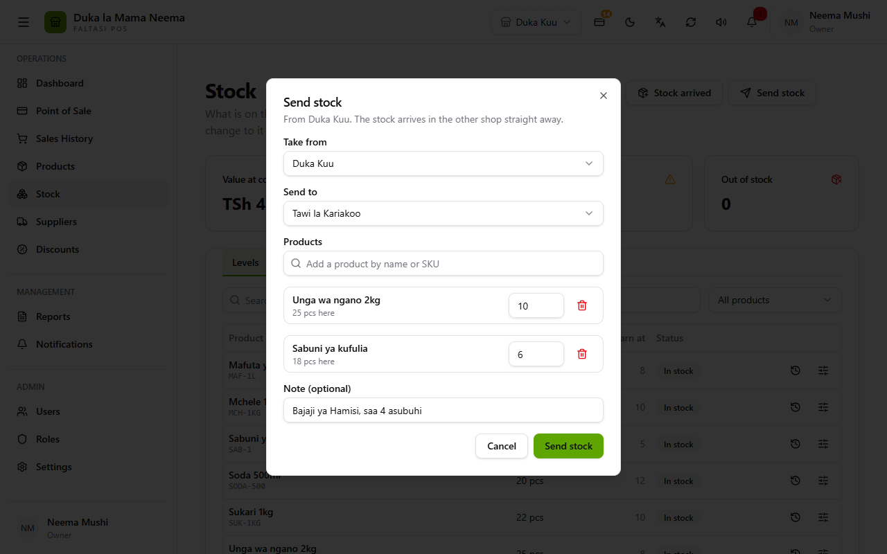
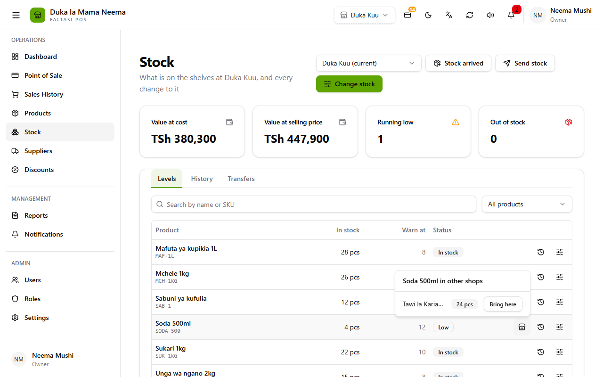
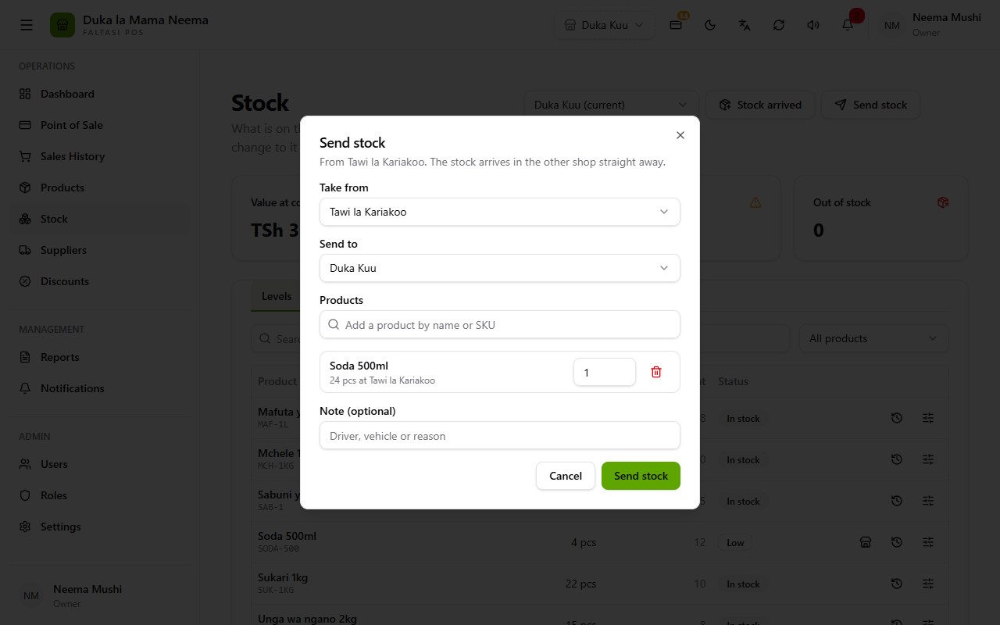
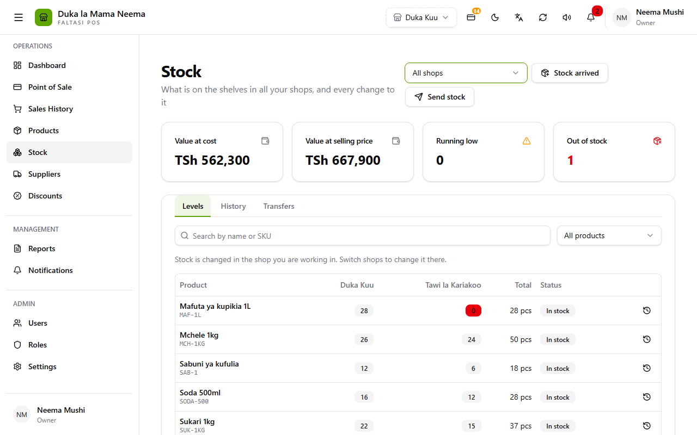
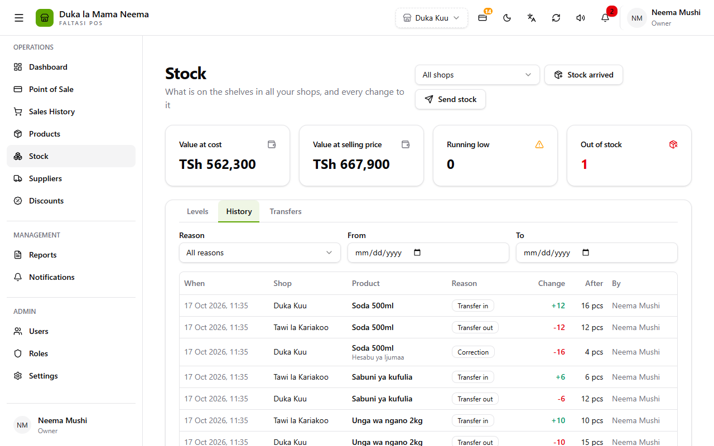
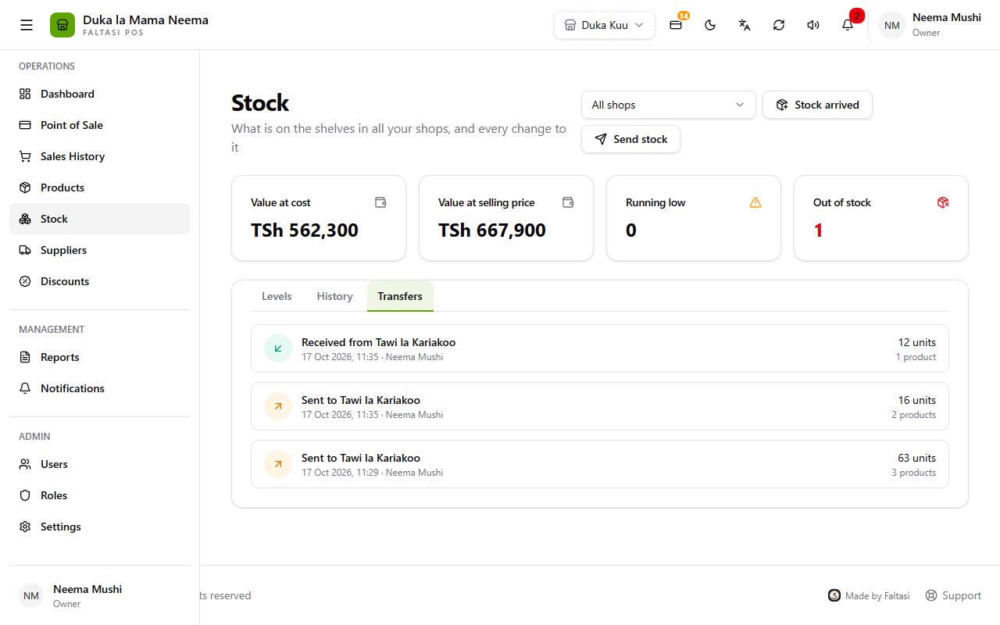
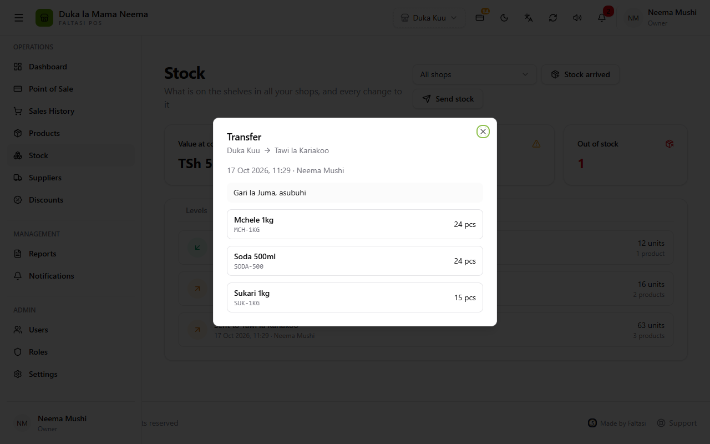

# Moving stock between shops

A guide for the Balce sales and support team. No technical knowledge needed. Button and field names are written as **English (Kiswahili)**, exactly as the app shows them.

When a business has more than one shop (branch, tawi), each shop counts its own stock. Moving stock from one shop to another is a **transfer (uhamisho)**:

- the sending shop goes **down** (Transfer out);
- the receiving shop goes **up** (Transfer in);
- both happen **at once**, the moment you press **Send stock**. There is no "in transit" step; send it when the stock actually leaves.

This only appears when the business has two or more shops. To add a shop: **Shops (Maduka)** → add a shop. To let staff work there, tick it under **Works in** on **Users** (see [the questions below](#common-questions)).

---

## 1. Send stock to another shop

1. Open **Stock (Stoku)**.
2. Press **Send stock (Tuma stoku)**.
3. Check **Take from** (usually your own shop) and choose **Send to**.
4. Search each product, tap it, and type how many.
5. Add a **Note** (who is carrying it), then press **Send stock**.

| Field | What it does |
| :--- | :--- |
| **Take from (Chukua kutoka)** | The shop the stock **leaves**. Starts on the shop you are working in. You can pick any shop you work in. **Changing it removes the products already added**, because the quantities belong to the old shop. |
| **Send to (Tuma kwa)** | The shop that **receives** it. It lists your other shops. If there is only one other shop, it is chosen for you. |
| **Products (Bidhaa)** | Search by name or SKU and tap the product. The search shows how many the **Take from** shop has. A product can be added once. |
| **Quantity** (the box on each row) | How many to move. A whole number above 0, and not more than the Take from shop has. Under the name it shows "25 pcs here" or "24 pcs at {shop}". |
| **Trash button** | Removes that product from the transfer. |
| **Note (optional) (Maelezo)** | "Driver, vehicle or reason": who carried it and when. It shows on the transfer details. |
| **Send stock (Tuma stoku)** | Moves the stock now and says "Stock sent". |

Messages you may see:

| Message | Meaning |
| :--- | :--- |
| Choose the shop to send to | **Send to** is empty. |
| Add at least one product | No products were added. |
| Enter a whole number above zero for {product} | The quantity is empty, 0 or has decimals. |
| Only {quantity} {unit} of {product} here / at {shop} | The Take from shop does not have that many. |
| You aren't assigned to this shop (Hujapangiwa duka hili) | Staff can only take stock from shops they work in. |

> When stock arrives in a shop that did not sell that product (**Sold in** unticked), the product is **switched on there automatically**, so it can be sold.

---

## 2. Bring stock in when a shop runs low

Use this when your shop is low or out, and you want to see who has some.

1. **Stock** → **Levels (Viwango)**, with the picker on your own shop.
2. On a product marked **Low** or **Out**, press the **shop** icon (**Other shops**).
3. The list shows how many each other shop has. Press **Bring here (Leta hapa)** next to the shop that has enough.

4. **Send stock** opens already filled in:
   - **Take from** = that shop;
   - **Send to** = your shop;
   - the product added, with quantity 1.
5. Type the quantity, add a note, and press **Send stock**.

| Part | What it does |
| :--- | :--- |
| **Other shops** (shop icon) | Only on **Low** or **Out** rows, when the business has other shops and the picker is on your own shop. |
| **{shop} — {quantity} pcs** | How many that shop has right now. |
| **Bring here (Leta hapa)** | Only for shops that have some, and only if you may change stock. |
| "No other shop has any." | Nobody has it: order it from a supplier (**Stock arrived**). |

Staff can only bring stock from shops they work in.

---

## 3. See every shop side by side

On the Stock page, set the picker at the top to **All shops (Maduka yote)**.

- **Levels** gets one column per shop plus **Total (Jumla)**. Each shop's number is coloured by its own status: grey in stock, outlined low, red out.
- The summary cards add up all your shops. **Running low** and **Out of stock** count a product if it is low or out in **any** shop.
- **History** gets a **Shop (Duka)** column, so you can see what each shop received, sold and moved.
- **Change stock** and the row sliders are hidden: stock is changed in the shop you are working in. Switch shops in the top bar to change another shop's stock.
- Staff see only the shops they work in, even with All shops.

In History, every transfer shows twice:

- **Transfer out (Uhamisho (imetoka))**, red −, in the sending shop;
- **Transfer in (Uhamisho (imeingia))**, green +, in the receiving shop.

---

## 4. Check past transfers

**Stock** → **Transfers (Uhamisho)** lists the transfers of **the shop you are working in**, newest first. The shop picker does not change this list; switch shops in the top bar to see another shop's transfers.

| Part | Meaning |
| :--- | :--- |
| Orange ↗ **Sent to {shop} (Imetumwa kwa)** | Stock that left this shop. |
| Green ↙ **Received from {shop} (Imepokelewa kutoka)** | Stock that came into this shop. |
| Date · name | When, and who sent it. |
| **units / products** | Total pieces, and how many different products. |

Tap a transfer to see its details: from → to, when, who, the note and every product with its quantity.

A transfer cannot be edited or deleted. To undo one, send the same stock back the other way.

---

## Common questions

**Who can send stock?**
Anyone whose role has **Create stock movements (Rekodi mienendo ya stoku)**, and who works in the shop the stock leaves. The owner can send between any shops.

**How do I let a cashier work in the branch?**
**Users (Watumiaji)** → edit the person → **Works in (Maduka anayofanyia kazi)**: tick the branch.

- To move someone to another shop, untick the old shop and tick the new one. They are signed out of the shop they lost and sign in to the new one.
- The **Works in** column on the Users list shows who works where.
- Someone who works in two shops switches between them with the shop name in the top bar.

**The receiving shop does not see the stock.**
Check that they are working in the right shop (the top bar). Then check Stock → **History**: there should be a **Transfer in** line. If the stock went to the wrong shop, send it on from there.

**Can I send stock from a shop I am not in?**
Yes, if you work in it: change **Take from**. **Bring here** does this for you.

**Why is there no "received" button?**
Stock arrives the moment it is sent. Send it when it actually leaves. If it does not arrive (lost on the road), the receiving shop records it with **Change stock → Damaged**, and adds a note.

**Can we send stock to a shop that is closed?**
No. Only open shops can send or receive. Open the shop again under **Shops** first.
